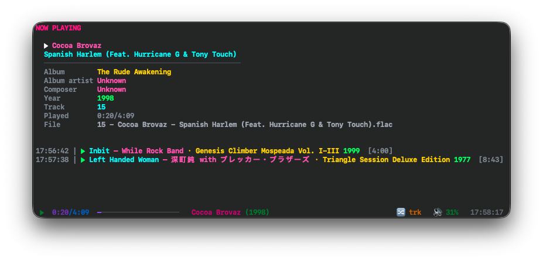

# cmus-now-playing

A full-screen cmus track watcher with detailed current-track information, play
history, playback controls, and a persistent status bar. The display uses
truecolor ANSI colors and stays in the foreground until Ctrl+C.



## Features

- Detailed current-track view with history below it
- Compact history-only view; switching views preserves session history
- Track and album navigation, pause, shuffle, seeking, and volume controls
- Filename fallback when a track has no title tag
- Terminal window title showing the current track

## Requirements

- `zsh`
- `cmus` with its remote-control socket available
- `awk` and standard terminal utilities
- macOS for volume fallback and start-time calculation

## Installation

```sh
install -m755 cmus-now-playing ~/.local/bin/cmus-now-playing
```

Make sure `~/.local/bin` is in your `PATH`, then run:

```sh
cmus-now-playing
```

Optional aliases:

```zsh
alias now='~/.local/bin/cmus-now-playing'
alias np='~/.local/bin/cmus-now-playing'
```

## Controls

| Key | Action |
| --- | --- |
| `1` | Detailed current track and history (default) |
| `2` | Compact history |
| `n` / `b` | Next / previous track |
| `N` / `B` | Next / previous album |
| Space | Play / pause |
| `s` | Toggle shuffle |
| `<` / `>` | Volume down / up |
| Left / Right | Seek 5 seconds back / forward |
| `c` | Clear history display |
| Ctrl+C | Quit |

## License

BSD 2-Clause — do whatever you want, keep the copyright notice, no warranty.
