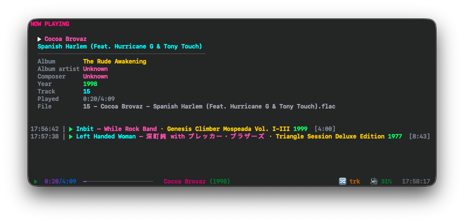

# cmus-now-playing

A dependency-free Bash script that prints the current playback status of
[cmus](https://cmus.github.io/) as a single formatted line, using only
`cmus-remote`. Built for tmux, Waybar, Polybar, i3blocks, Conky, and shell
prompts.



## Features

- Custom output formats with non-recursive placeholder expansion
- Filename fallback when a track has no title tag
- Network stream-title support
- Optional output truncation and empty output when stopped
- Waybar-compatible JSON with proper escaping
- Clear exit codes and a quiet mode
- Bash 3.2 and later, including the Bash bundled with macOS

## Requirements

- Bash 3.2+
- cmus, with its remote-control socket available

## Installation

Install to `~/.local/bin` with curl:

```sh
curl -fsSL http://gentoo.local:3000/mArdek/cmus-now-playing/raw/branch/main/install.sh | bash
```

To install somewhere else, set `PREFIX`:

```sh
curl -fsSL http://gentoo.local:3000/mArdek/cmus-now-playing/raw/branch/main/install.sh | PREFIX="$HOME/.local" bash
```

For system-wide installation, download the installer first and run it with the
desired privileges after inspecting it:

```sh
curl -fsSLO http://gentoo.local:3000/mArdek/cmus-now-playing/raw/branch/main/install.sh
sudo PREFIX=/usr/local bash install.sh
```

Alternatively, install a local checkout directly:

```sh
mkdir -p ~/.local/bin
install -m755 cmus-now-playing ~/.local/bin/cmus-now-playing
```

Make sure the installation directory is in your `PATH`:

```sh
export PATH="$HOME/.local/bin:$PATH"
```

## Usage

```text
cmus-now-playing [OPTIONS]

  -f, --format FORMAT   output format string (default: "{artist} - {title}")
  -s, --state           print only the player state
  -m, --max-length N    truncate to N characters, adding an ellipsis
  --empty-stopped       print nothing when playback is stopped
  --json                print Waybar-compatible JSON
  -q, --quiet           suppress error messages
  -h, --help            show help
```

### Format placeholders

| Placeholder | Meaning | Example |
| --- | --- | --- |
| `{state}` | player state | `playing` |
| `{state_icon}` | state icon | `▶ ⏸ ■` |
| `{artist}` | track artist | `Burial` |
| `{title}` | track title or filename fallback | `Archangel` |
| `{album}` | album name | `Untrue` |
| `{tracknumber}` | track number | `3` |
| `{date}` | release date or year | `2007` |
| `{duration}` | track length | `5:09` |
| `{position}` | elapsed time | `2:14` |
| `{remaining}` | time left | `2:55` |
| `{file}` | full file path | `/music/…` |
| `{stream}` | network stream title | `NTS Radio` |

Times use `mm:ss`, or a longer minute count when needed. Unknown placeholders
remain unchanged.

### Exit codes

| Code | Meaning |
| --- | --- |
| `0` | cmus is running and a state was reported |
| `1` | cmus is not running or `cmus-remote -Q` failed |
| `2` | invalid arguments |
| `127` | `cmus-remote` is not installed |

## Examples

```sh
cmus-now-playing
# Burial - Archangel

cmus-now-playing -f '{state_icon} {artist} - {title} [{position}/{duration}]'
# ▶ Burial - Archangel [2:14/5:09]

cmus-now-playing --json --max-length 40
# {"text":"▶ Burial - Archangel","alt":"playing","class":"playing"}

cmus-now-playing --empty-stopped --max-length 30
cmus-now-playing --state
# playing
```

Waybar custom module:

```json
"custom/cmus": {
  "exec": "cmus-now-playing --json --empty-stopped --max-length 40",
  "return-type": "json",
  "interval": 1
}
```

## Development

Run the test suite and syntax checks:

```sh
bash tests/run.sh
bash -n cmus-now-playing install.sh
```

The tests use a mock `cmus-remote`; cmus does not need to be running.

## License

BSD 2-Clause. See [LICENSE](LICENSE).
